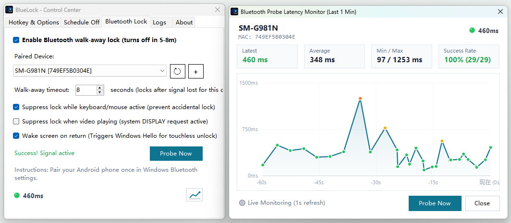

BlueLock is a lightweight, privacy-focused productivity tool for Windows that brings intelligent Bluetooth walk-away auto-lock, instant display power-off, and smart sleep prevention to your desktop.

## Install
winget install bluelock

## Screenshot

## Key Highlights:

1. Bluetooth Walk-Away Auto-Lock:
Pair your smartphone or smartwatch with Windows. When you step away from your workstation (5–8 meters), BlueLock automatically turns off your monitors and locks the workstation within seconds to protect your privacy.

2. Auto Screen-On on Return:
Wakes display when you return with your phone for seamless Windows Hello facial unlock

3. Smart Anti-Accidental Lock:
Zero false triggers. BlueLock automatically suppresses locking while keyboard or mouse activity is detected, or when videos and presentations are playing (active system DISPLAY requests).

4. Instant Hotkey & Tray Lock:
Turn off screens or lock the system instantly using customizable global hotkeys, a tray icon double-click, or CLI commands.

5. Screen-Off Only Mode:
Turn off monitor power immediately without locking Windows or interrupting background tasks—ideal for overnight downloads, music playback, and preserving OLED screen health.

6. Keep Awake (Caffeine Mode):
Temporarily prevent Windows from going to sleep or locking screens during long compile jobs, presentations, or render tasks (supports 1h, 2h, 4h, or indefinite duration).

7. Scheduled Timers:
Schedule an automatic lock or screen-off using countdown minutes or an exact time of day.

8. Lightweight & 100% Offline:
Pure local execution with zero network tracking, negligible CPU usage, and under 20MB memory footprint.
